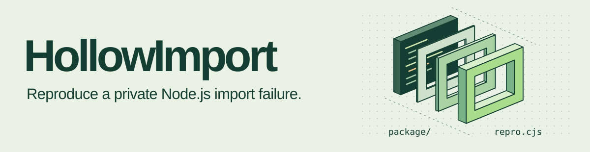
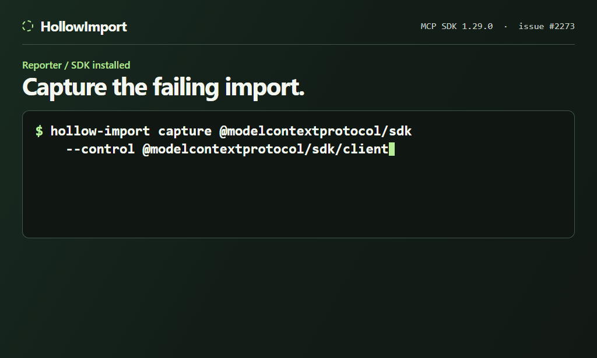

<h1>
  <picture>
    <source media="(max-width: 600px)" srcset="docs/media/hollow-import-compact.svg">
    
  </picture>
</h1>

[](https://www.npmjs.com/package/hollow-import)   [](LICENSE)

**Your import broke. The maintainer asks for a minimal repro. Your code is private.**

HollowImport turns that failure into **one `repro.cjs`** that replays the same Node.js error on anyone's machine — with no source code, no package names and no paths from your project. The maintainer runs `node repro.cjs` and sees `MATCH`.

```sh
npx hollow-import demo --out try.cjs && node try.cjs
```

[18-second overview (MP4)](https://github.com/etehofk1-ops/HollowImport/releases/download/v0.1.0/hollow-import-promo-v2.mp4) · [Capture](#capture-your-own) · [Privacy](#what-gets-shared) · [Scope](#supported-cases) · [MIT license](LICENSE)

<picture>
  <source media="(prefers-reduced-motion: reduce)" srcset="docs/media/capture-replay-still.png">
  
</picture>

## Seeing one of these?

If an installed package fails to resolve with one of these errors, HollowImport can capture it:

```text
Error [ERR_PACKAGE_PATH_NOT_EXPORTED]: Package subpath './lib/use/ws' is not defined by "exports" in .../node_modules/<pkg>/package.json
Error [ERR_PACKAGE_PATH_NOT_EXPORTED]: No "exports" main defined in .../node_modules/<pkg>/package.json
Error [ERR_MODULE_NOT_FOUND]: Cannot find module '.../node_modules/<pkg>/dist/index.js' imported from ...
Error: Cannot find module '.../node_modules/<pkg>/dist/index.cjs'  (code: 'MODULE_NOT_FOUND')
Error [ERR_UNSUPPORTED_DIR_IMPORT]: Directory import '.../node_modules/<pkg>/utils' is not supported resolving ES modules imported from ...
```

Typical causes: a subpath removed in a major version, a package that works with `require` but not `import` (or the reverse), a missing root `"."` entry, an `exports` target pointing at a file that was never published, and `import` vs `require` / custom condition branches that disagree.

Not covered: `ERR_REQUIRE_ESM`, errors thrown while the module runs, TypeScript `paths`, and Vite/Webpack/Jest resolver settings. Those need a different reproduction.

## Replay a real import migration

Open a terminal in the cloned or extracted HollowImport folder. The example needs only **Node 22.15+ (22.x) or Node 24+**.

```sh
node examples/graphql-ws-v6.cjs
```

In v6, `graphql-ws/lib/use/ws` fails and `graphql-ws/use/ws` works. Look for `MATCH` on replay. [Upstream migration note](https://github.com/enisdenjo/graphql-ws/releases/tag/v6.0.0)

The recording above follows a synthetic private package, `@acme/payments-sdk`, from the failed import to `MATCH` in an empty folder. Its terminal text is real CLI output. [Watch the MP4 with sound](docs/media/capture-replay.mp4) · [View a still](docs/media/capture-replay-still.png)

Another real case: the MCP SDK's missing root entry. [SDK issue #2273](https://github.com/modelcontextprotocol/typescript-sdk/issues/2273) · [Replay source](examples/sdk-2273.cjs) · [Report preview](examples/report-preview.png)

<details>
<summary>Compare the graphql-ws package lint with the consumer's lookup</summary>

On the graphql-ws 6.0.0 tarball, publint 0.3.25 reported a root type-declaration warning and a browser-field suggestion. It had no consumer import as input. Native Node rejected the old path and resolved the new path. HollowImport captured those requests as `sample-lib/unlisted-1` and `sample-lib/entry-2` so a recipient can replay them without the package.

The rename was intentional. A match verifies the recorded outcomes in the fixture. Use the original package and configuration to investigate their cause.

</details>

## Capture your own

**Reporter.** Replace the example package name and consumer path below. Point `--from` at the directory containing the file with the failing import. The package must already be installed and reachable from there. The command writes `repro.cjs` in your current directory and requires a new output filename.

```sh
npx hollow-import capture @company/library/internal --from /path/to/consumer --out repro.cjs
```

From a clone of this repository, run `node cli.cjs` in place of `npx hollow-import`.

**For a GitHub issue.** Run the command below and attach only `proof.html` to your issue comment. It contains the results table and a downloadable copy of `repro.cjs`. [GitHub attachment formats](https://docs.github.com/en/get-started/writing-on-github/working-with-advanced-formatting/attaching-files#supported-file-types)

```sh
node repro.cjs --card proof.html
```

**Maintainer.** Open the downloaded report locally and choose **Download repro.cjs**. Read the script in a text editor. To replay, place it in an empty directory and run:

```sh
node repro.cjs
```

`MATCH` means the replay produced the recorded error codes and resolved the working imports to their expected anonymous files.

<details>
<summary>Choose a working control or a custom export condition</summary>

If every mode fails for the requested entry, HollowImport tries the package root as a control. If the root is the broken entry, specify a working subpath from the same package:

```sh
npx hollow-import capture @company/library --from /path/to/consumer --control @company/library/client --out repro.cjs
```

Add `--condition development` to compare the default conditions with a second run. Private condition names become numbered flags. When ambient Node flags, `NODE_OPTIONS` or `NODE_PATH` are present, use a clean shell or explicitly opt into stock resolution with `--clean`.

</details>

<details>
<summary>Export Markdown, inspect the data or unpack an editable fixture</summary>

To paste the verified results into an issue, use `node repro.cjs --markdown`.

- `node repro.cjs --unpack editable-repro` creates an editable package tree and a command that triggers the native failure.
- `node repro.cjs --inspect` prints the recorded fixture data.

To see the bundled [example report](examples/sdk-2273.html) from a checkout, open `examples/sdk-2273.html` in your browser. To practice the capture step, run `npx hollow-import demo --out practice.cjs`.

</details>

## What gets shared

| Included in the file | Stays in the original project |
| --- | --- |
| Node version, selected export branches and their order | Source contents, private package names and original paths |
| Target extensions, file existence and anonymous target identities | Lockfiles, environment values and raw error messages |

Capture uses Node's native ESM resolver and CommonJS `require.resolve`. It stops before loading the target module, builds a synthetic package with empty stub files, and replays it locally. A mismatch or missing working control stops the export.

## Supported cases

Installed packages with an `exports` map, including exact subpaths, conditional branches and simple wildcards. Exact entries take priority. The fixture preserves the selected routes for the recorded requests. Overlapping wildcard candidates and aliases whose identities cannot be preserved are declined.

The check ends at **native resolution**. TypeScript path mappings, Vite/Webpack resolution, custom loaders and errors during module initialization require a different reproduction.

## Development

```sh
npm test
npm pack --dry-run --ignore-scripts
```

To contribute a case, include the Node version, one failing bare import and a working control using public or synthetic package data.
